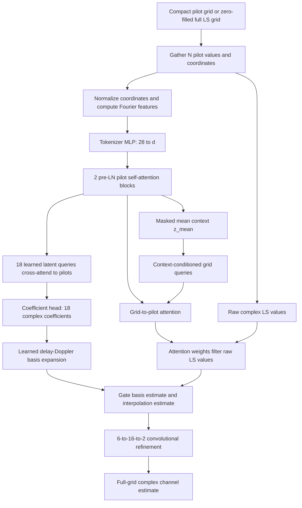

# PACE-Net Architecture and Data Flow

This document describes the PACE-Net implementation currently in this repository. PACE-Net is a proposed model; its implementation and current experiment results do not establish that it outperforms AttRNet or genie LMMSE.

## 1. Task and tensor conventions

PACE-Net estimates the full complex channel over a 72-subcarrier by 14-symbol OFDM grid from noisy least-squares (LS) observations at pilot locations.

| Quantity | Shape | Meaning |
|---|---|---|
| Compact dataset input | `[B, 2, P_f, P_t]` | Real and imaginary LS values at a rectangular, uniform pilot grid |
| Full-grid sparse input | `[B, 2, 72, 14]` | Zero-filled LS grid for an irregular pilot mask |
| Pilot token values | `[B, N, 2]` | One `(real, imag)` LS value per pilot |
| Coordinates | `[N, 2]` or `[B, N, 2]` | Integer `(subcarrier, OFDM symbol)` indices, zero-based |
| Padding mask | `[B, N]` or `None` | `True` means the token is ignored |
| Target and prediction | `[B, 2, 72, 14]` | Real and imaginary parts of the full channel |

The channel axis uses index 0 for real and index 1 for imaginary. The loss is the repository's complex-channel MSE:

```python
(prediction - target).square().sum(dim=1).mean()
```

The saved datasets keep the compact pilot values as `[sample, real_imag, pilot_frequency, pilot_time]`. Uniform coordinates come from the dataset manifest. MATLAB manifests store them one-based, so the training adapter subtracts one when it builds model coordinates. Compact pilots are flattened frequency first and time second. This ordering matches the manifest's nested `(frequency, time)` coordinate construction. See [`SavedOFDMDataset`](attrnet_ofdm/data.py#L115) and [`coords_from_manifest`](train_pacenet.py#L31).

For the 24-pilot dataset used in the example run below, each input is `[2,6,4]` and each target is `[2,72,14]`. Its six zero-based subcarrier coordinates are `[0,14,28,43,57,71]`; its four symbol coordinates are `[0,4,9,13]`. Their Cartesian product gives 24 pilot locations in frequency-major/time-minor order. The train, validation, and test splits contain 12,000, 4,000, and 4,000 samples. Each split has an SNR label for every sample, with 800 samples per SNR value (0, 5, 10, 15, or 20 dB). The SNR label is used for reporting validation/test metrics; it is not passed to the network.

## 2. End-to-end flow



The two estimation branches provide different paths from the pilots to the full grid. The coefficient branch produces a compact delay-Doppler representation and expands it over the grid. The linear branch computes pilot attention weights for each grid point and applies those weights directly to the original complex LS values.

## 3. Input adaptation and coordinates

`to_pilot_tokens` in [`pacenet.py`](attrnet_ofdm/pacenet.py#L224) converts the input batch to the model's token interface.

### Uniform pilot input

For a saved dataset input `[B, 2, P_f, P_t]`, the adapter permutes it to `[B, P_f, P_t, 2]` and flattens the two pilot-grid axes. With 24 pilots, for example, the input is `[B, 2, 6, 4]`, and the result is `[B, 24, 2]`. The supplied coordinates must use the matching frequency-major/time-minor order; the adapter does not reorder them.

### Irregular pilot input

For a sparse `[B, 2, 72, 14]` input, the adapter gathers at the supplied `(f,t)` coordinates. The optional `--pilot-indices` training path gets these zero-filled grids from the joint-pilot dataset utility, whose flattened coordinate convention is `f * 14 + t`. The saved order is retained.

### Coordinate features

Coordinates are normalized as:

```text
f_norm = f / (Nf - 1)
t_norm = t / (Nt - 1)
```

For each coordinate component, `fourier_features` computes sine and cosine features at six frequencies `2^i * pi`, then appends the two normalized coordinates. That produces 26 coordinate features. Concatenating the two LS value components gives 28 tokenizer inputs per pilot. Implementation: [`fourier_features`](attrnet_ofdm/pacenet.py#L43).

## 4. Model stages

The stage descriptions below use the current `pace_s` preset: `d=16`, 4 attention heads, two pilot encoder blocks, one latent cross-attention block, `L=6`, `K=3`, and a 72 by 14 output grid. `d` must be divisible by the number of heads. The current `pace_m` preset uses `d=64`.

| Preset | `d` | Heads | Trainable parameters |
|---|---:|---:|---:|
| `pace_s` | 16 | 4 | 11,457 |
| `pace_m` | 64 | 4 | 128,529 |

### Stage 1: Pilot tokenizer

For each pilot, the tokenizer concatenates its LS value and coordinate features:

```text
[real, imag, normalized coordinate/Fourier features] : [B,N,28]
MLP: Linear(28,d) -> GELU -> Linear(d,d)
tokens: [B,N,d]
```

With the current `pace_s`, token width is 16. With `pace_m`, it is 64. By default, LS values are not normalized. If `input_rms_norm=True`, the model divides the values by each sample's pilot RMS and multiplies its final output by that scale.

### Stage 2: Pilot encoder and context

Two [`EncoderBlock`](attrnet_ofdm/pacenet.py#L49) modules apply pre-LayerNorm self-attention over the pilot sequence. Each block has:

1. LayerNorm, multi-head self-attention, and a residual addition.
2. LayerNorm, a `d -> 2d -> d` GELU feed-forward network, and another residual addition.

The attention mask ignores padded pilots when a padding mask is provided. The output is `Z: [B,N,d]`. A masked mean over pilots produces `z_mean: [B,d]`; this context conditions both the fusion gate and the linear-branch grid queries.

### Stage 3: Latent coefficient decoder

The model owns `L*K = 18` learned latent query vectors, initialized with small random values. A [`LatentBlock`](attrnet_ofdm/pacenet.py#L63) cross-attends these queries to the encoded pilot tokens `Z`, with pre-normalized queries, keys, and values, residual connections, and a feed-forward network. Optional latent self-attention is controlled by `latent_self_attn` and defaults to off.

The coefficient head maps each decoded query to two real numbers, interpreted as real and imaginary parts. Reshaping gives `[B,L,K,2]`, or complex coefficients `C: [B,6,3]` for the default preset. The head weights are initialized with standard deviation 0.01 and its bias is zero.

### Stage 4: Delay-Doppler basis expansion

[`DelayDopplerBasis`](attrnet_ofdm/pacenet.py#L80) initializes two complex bases:

```text
Bf[f,l] = exp(-j 2 pi f (l * delay_step) / Nf)
Bt[t,k] = exp(+j 2 pi (t - (Nt-1)/2) nu[k] / Nt)
nu[k] = (k - (K-1)/2) * doppler_step
```

The current defaults are `delay_step=0.5` and `doppler_step=0.1`. Real and imaginary basis components are stored as parameters. `learnable_basis=True` allows them to change during training; setting it to `False` freezes their DFT-style initialization.

The expansion is:

```text
H_basis[b,f,t] = sum_l sum_k Bf[f,l] * C[b,l,k] * Bt[t,k]
H_basis: complex [B,72,14]
```

Basis expansion runs in float32 even under autocast. `_complex_to_ri` converts the result to `[B,2,72,14]` for fusion.

### Stage 5: Attention-weighted linear interpolation branch

When enabled, the model creates one normalized coordinate query for each of the 1008 output-grid positions. A grid embedding MLP maps Fourier coordinate features to `d` dimensions. The projected context `ctx_to_q(z_mean)` is added to every grid query, making the weights depend on the sample's pilot context as well as location.

[`LinearInterp`](attrnet_ofdm/pacenet.py#L103) projects grid queries and pilot tokens into four attention heads. For each grid position and head it computes scores over the pilots:

```text
logits: [B, heads, 1008, N]
```

With the default `linear_attn_signed=False`, a softmax over `N` produces nonnegative weights summing to one. Crucially, the weights are applied to the **raw complex LS pilot values**, not to learned value vectors. The four head outputs are combined using learned complex head gains to produce `H_lin: complex [B,72,14]`. This calculation also runs in float32 under autocast. If `linear_attn_signed=True`, scores use the implementation's `tanh(logits)/sqrt(N)` signed weighting instead.

### Stage 6: Gated fusion

When both branches are enabled, a linear layer maps `z_mean` to a scalar gate. The sigmoid gate blends the two real/imaginary grid estimates:

```text
g = sigmoid(gate(z_mean))                # one scalar per sample
H0 = g * H_basis + (1-g) * H_lin         # [B,2,72,14]
```

The gate's bias is initialized to zero. Its weights use PyTorch's standard linear-layer initialization, so the initial gate is not guaranteed to be exactly 0.5 for every sample. With `use_basis=False`, `H0` is `H_lin`; with `use_linear_branch=False`, `H0` is `H_basis`.

### Stage 7: Convolutional residual refinement

When `use_refine=True`, the model concatenates `H0`, `H_basis`, and `H_lin` along the channel axis, giving six input channels. If a branch is disabled, its refinement input is zeros. The refinement network is:

```text
Conv2d(6,16,kernel_size=3,padding=1)
GELU
Conv2d(16,2,kernel_size=3,padding=1)
```

The last convolution's weights and bias are initialized to zero, so at initialization the refinement residual is exactly zero. The final estimate is `H_hat = H0 + refinement`. If `use_refine=False`, the estimate is simply `H0`.

### Output and optional RMS rescaling

The final tensor is `[B,2,72,14]`, with real and imaginary components on channel axis 1. If input RMS normalization is enabled, the stored per-sample scale is multiplied back into this output. Main forward path: [`PACENet.forward`](attrnet_ofdm/pacenet.py#L166).

## 5. Ablation/configuration switches

`PACEConfig` in [`pacenet.py`](attrnet_ofdm/pacenet.py#L12) exposes architecture and branch settings.

| Setting | Effect |
|---|---|
| `d`, `heads` | Token width and attention-head count; `d % heads` must be zero |
| `n_enc_blocks`, `n_lat_blocks`, `ffn_mult`, `dropout` | Encoder/latent depth and feed-forward regularization |
| `L`, `K`, `delay_step`, `doppler_step` | Number and initialization of latent coefficients and basis support |
| `learnable_basis` | Train or freeze the initialized delay-Doppler basis |
| `use_basis` | Enable/disable coefficient decoding and basis expansion |
| `use_linear_branch` | Enable/disable grid-query attention over raw pilot observations |
| `linear_attn_signed` | Use signed tanh weights instead of softmax weights |
| `use_refine` | Enable/disable convolutional residual refinement |
| `latent_self_attn` | Add self-attention between latent queries |
| `input_rms_norm` | Normalize pilot RMS and rescale the output |
| `n_fourier`, `Nf`, `Nt` | Coordinate encoding frequencies and grid size |

At least one of `use_basis` and `use_linear_branch` must be enabled. The PACE training CLI maps `--no-basis`, `--no-linear-branch`, `--fixed-basis`, `--signed-linear`, and `--no-refine` to these switches.

## 6. Training and checkpoint selection

[`train_pacenet.py`](train_pacenet.py#L58) uses the repository's saved train, validation, and test splits. For the current CLI defaults it sets dropout to 0.1, trains with AdamW at learning rate `1e-3` and weight decay `1e-2`, linearly warms the learning rate for five epochs, then applies cosine decay. It uses batch size 128 and 100 epochs unless overridden.

The checkpoint is selected by the lowest validation MSE. The test split is evaluated only after training and checkpoint selection. The loss is defined in [`loss_fn`](attrnet_ofdm/pacenet.py#L246) and matches the direct expression in the existing AttRNet trainer. Run configuration, per-epoch train/validation MSE and learning rates, the best checkpoint, and per-SNR test metrics are written under the run output directory.

Example training command:

```powershell
python train_pacenet.py --pilots 24 --data-dir matlab_epa7_24pilots --epochs 100 --batch-size 128 --seed 2025 --preset pace_s --dropout 0.1 --learning-rate 1e-3 --weight-decay 1e-2 --warmup-epochs 5
```

## 7. Walkthrough of the seed-2027 training run

The following command uses the data and settings described in this section:

```powershell
python train_pacenet.py --pilots 24 --data-dir matlab_epa7_24pilots --epochs 100 --batch-size 128 --seed 2027 --preset pace_s --dropout 0.1 --learning-rate 1e-3 --weight-decay 1e-2 --warmup-epochs 5
```

### Before the first training step

1. The script seeds Python, NumPy, PyTorch, and CUDA with 2027. This controls model initialization and the shuffled training order. It does not regenerate or alter the saved MATLAB dataset; its manifest records a separate dataset-generation seed of 2025.
2. `SavedOFDMDataset` opens the saved train split. The trainer wraps validation and test datasets to also return each sample's SNR label.
3. `PACEConfig.preset("pace_s")` sets `d=16`, four attention heads, two encoder blocks, one latent decoder block, `L=6`, `K=3`, and both output branches plus refinement. The CLI sets dropout to 0.1. This model has 11,457 trainable parameters.
4. The manifest coordinates are converted to zero-based values and kept in frequency-major/time-minor order. The adapter maps each `[B,2,6,4]` input to `[B,24,2]` and supplies its `[24,2]` coordinates.

### Per-epoch training and validation

There are `ceil(12,000 / 128) = 94` training batches per epoch. The last batch has 32 samples. Each batch performs a forward pass, computes `(prediction - target).square().sum(dim=1).mean()`, backpropagates, and applies an AdamW update. All 100 epochs therefore have 9,400 optimizer steps.

The learning rate increases linearly from about `2.13e-6` on the first update to `1e-3` at the end of epoch 5 (470 updates). It then follows cosine decay through the remaining updates. Weight decay is `1e-2`. Dropout is applied in the attention and feed-forward blocks that receive the configured dropout value; the convolutional refinement block has no dropout layer.

After each epoch, validation runs over all 4,000 validation samples in 32 batches. It groups the pooled complex-channel MSE by SNR and takes the equal-weight mean of the five SNR MSEs as the checkpoint-selection value. The checkpoint with the lowest such validation MSE is retained; test samples do not influence this choice.

### Final test evaluation and saved artifacts

After epoch 100, the trainer reloads the best validation checkpoint and evaluates all 4,000 held-out test samples. The test metric for each SNR is pooled over its 800 samples: MSE is mean squared complex error per resource element, and NMSE is total squared error divided by total target energy.

The completed seed-2027 run saved its files under [`runs/pacenet_24_pace_s_d16_uniform_seed2027_adamw/`](runs/pacenet_24_pace_s_d16_uniform_seed2027_adamw/). Its config records 9,400 total updates, 470 warmup updates, and 11,457 parameters. Training took about 379 seconds; the lowest validation MSE was 0.0211373.

| Test SNR (dB) | MSE | NMSE | NMSE (dB) |
|---:|---:|---:|---:|
| 0 | 0.0619130 | 0.0626401 | -12.0315 |
| 5 | 0.0244718 | 0.0248130 | -16.0532 |
| 10 | 0.0100682 | 0.00971768 | -20.1244 |
| 15 | 0.00433626 | 0.00434885 | -23.6163 |
| 20 | 0.00217889 | 0.00234257 | -26.3031 |

These are results from one seed and one test split; they are not evidence that PACE-Net outperforms another estimator. The per-epoch history is in [`train_log.json`](runs/pacenet_24_pace_s_d16_uniform_seed2027_adamw/train_log.json), the full run settings in [`config.json`](runs/pacenet_24_pace_s_d16_uniform_seed2027_adamw/config.json), and the test metrics in [`metrics.json`](runs/pacenet_24_pace_s_d16_uniform_seed2027_adamw/metrics.json).

The evaluator rebuilds the architecture from the saved checkpoint configuration and reports per-SNR MSE/NMSE plus runtime and profiler metrics. See [`evaluate_pacenet.py`](evaluate_pacenet.py).

## 8. Key implementation references

- Configuration and presets: [`PACEConfig`](attrnet_ofdm/pacenet.py#L12)
- Coordinate Fourier features: [`fourier_features`](attrnet_ofdm/pacenet.py#L43)
- Pilot self-attention: [`EncoderBlock`](attrnet_ofdm/pacenet.py#L49)
- Latent cross-attention decoder: [`LatentBlock`](attrnet_ofdm/pacenet.py#L63)
- Delay-Doppler expansion: [`DelayDopplerBasis`](attrnet_ofdm/pacenet.py#L80)
- Raw-LS attention interpolation: [`LinearInterp`](attrnet_ofdm/pacenet.py#L103)
- End-to-end architecture: [`PACENet`](attrnet_ofdm/pacenet.py#L133)
- Input adapter: [`to_pilot_tokens`](attrnet_ofdm/pacenet.py#L224)
- Dataset and saved manifest loading: [`SavedOFDMDataset`](attrnet_ofdm/data.py#L115)
- Training, validation checkpoint rule, and final test metrics: [`train_pacenet.py`](train_pacenet.py)
- Evaluation and complexity measurement: [`evaluate_pacenet.py`](evaluate_pacenet.py)

